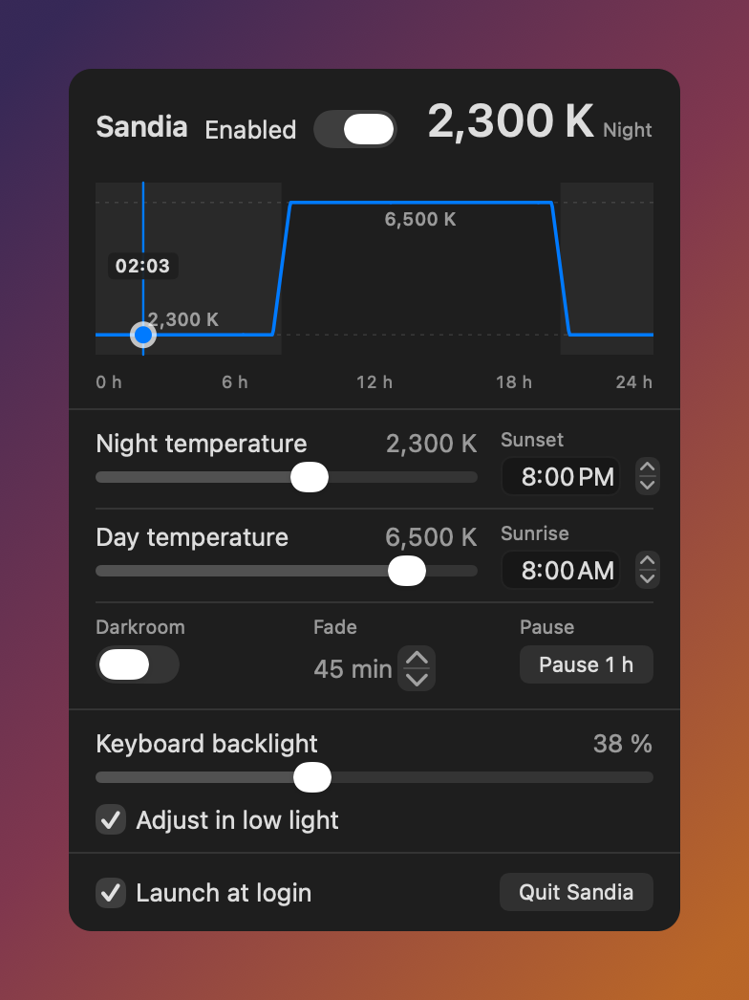

# Sandia

**Français** · [English](README.md)

Application de barre des menus pour macOS qui réchauffe l'écran le soir en agissant sur les tables gamma, comme f.lux. Elle remplace f.lux sur nos Mac.



## Installer

Télécharger le DMG depuis [Releases](https://github.com/Smax2k/sandia/releases), l'ouvrir et glisser **Sandia.app** dans **Applications**. Le DMG est signé Developer ID et notarié par Apple : Gatekeeper l'ouvre sans avertissement.

macOS 15 (Sequoia) ou plus récent. L'app vit dans `/Applications` : c'est de là que « Lancer à l'ouverture » fonctionne.

## Ce qu'elle fait

- Courbe de température sur 24 h, avec un repère d'heure lisible.
- Températures de nuit et de jour réglables, de 1 000 K à 12 000 K, neutres à 6 504 K (D65).
- Fondu progressif autour du coucher et du lever.
- Pause d'une heure, sans perdre la courbe.
- Molette et défilement à deux doigts sur le curseur sous le pointeur.
- **Darkroom** : écran rouge très sombre pour la nuit.
- Rétroéclairage clavier, y compris le réglage automatique en faible lumière.
- Lancement à l'ouverture.
- Interface en anglais, traduite en français quand le système est en français.

## Construire

Le projet Xcode est généré par [XcodeGen](https://github.com/yonaskolb/XcodeGen) depuis `project.yml`, et le `.xcodeproj` produit est versionné : Xcode s'ouvre directement, sans rien installer.

```sh
open Sandia.xcodeproj      # puis ⌘R
```

Après une régénération (`brew install xcodegen`) :

```sh
xcodegen generate
xcodebuild -project Sandia.xcodeproj -scheme Sandia -configuration Release build
```

Tests (78) :

```sh
swift test
xcodebuild test -project Sandia.xcodeproj -scheme Sandia -destination 'platform=macOS'
```

## Release signée et DMG

`scripts/release.sh` construit, signe avec le certificat **Developer ID Application**, notarie, agrafe et produit `dist/Sandia-<version>.dmg`. La notarisation utilise le profil `asc` déjà présent sur la machine : aucun secret n'est saisi.

```sh
./scripts/release.sh
```

## Captures d'écran

`scripts/screenshot.swift` rend le panneau réel en anglais dans `docs/screenshot.png`, sans toucher aux réglages de l'app installée :

```sh
swift build -c debug
BIN=$(swift build -c debug --show-bin-path)
swiftc -swift-version 5 -I "$BIN" \
    Sources/Sandia/Preferences.swift Sources/Sandia/PanelView.swift \
    Sources/Sandia/ScrollWheelSlider.swift \
    Sources/Sandia/CurveView.swift Sources/Sandia/Localization.swift \
    scripts/screenshot.swift "$BIN/SandiaCore.o" -o .build/screenshot
.build/screenshot docs/screenshot.png -AppleLocale en_US -AppleLanguages '(en)'
```

## Origine

Fork personnel de [fabianwgl/dvsk](https://github.com/fabianwgl/dvsk) (MIT), repris au commit `86f149a` après relecture complète du code : aucune dépendance externe, aucun appel réseau, aucun sous-processus, la seule API privée étant `CoreBrightness` pour le rétroéclairage clavier.

**On ne suit pas les mises à jour de l'amont.** Un mainteneur peut modifier son dépôt à tout moment ; une mise à jour automatique importerait du code non relu. Si une correction amont nous intéresse, elle est relue et réappliquée à la main.

Le fichier `LICENSE` d'origine est conservé : le code dérive d'un projet MIT.

## Organisation

- `Sources/SandiaCore/` — logique pure, sans AppKit : couleur, horaire, calcul solaire. C'est là que vont les tests.
- `Sources/Sandia/` — interface : icône de barre des menus, popover, gamma, rétroéclairage.
- `Resources/*.lproj/Localizable.strings` — traductions ; l'anglais est la langue de base.
- `Tests/SandiaCoreTests/` — tests unitaires de `SandiaCore`.
- `project.yml` — source du projet Xcode. Ne pas éditer `Sandia.xcodeproj` à la main : il est régénéré.

## Si l'écran reste teinté

Après un plantage ou un `kill -9`, les couleurs peuvent rester chaudes :

```sh
/Applications/Sandia.app/Contents/MacOS/Sandia --reset
```

## Limites connues

- Ne pas faire tourner f.lux en même temps : les deux réécrivent les mêmes tables gamma et la teinte clignote.
- Désactiver Night Shift et True Tone (Réglages Système → Écrans), qui se cumulent.
- Le rétroéclairage clavier passe par une API privée (`CoreBrightness`) : chaque sélecteur est testé et la section disparaît si macOS ne l'expose plus.

## Licence

MIT — voir [LICENSE](LICENSE).
