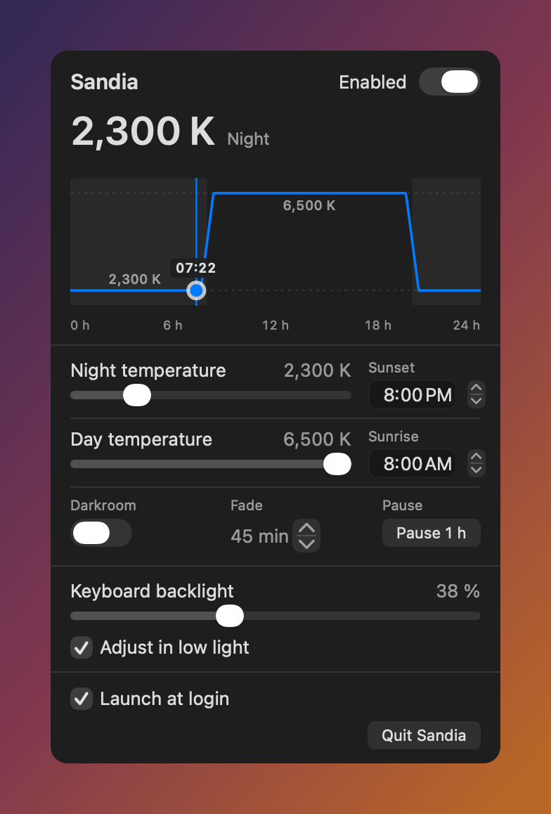

**English** · [Français](README.fr.md)

# Sandia

A tiny macOS menu bar app that warms the screen in the evening by rewriting the display gamma tables, like f.lux. It replaces f.lux on our Macs.



## Install

Download the DMG from [Releases](https://github.com/Smax2k/sandia/releases), open it and drag **Sandia.app** into **Applications**. The DMG is Developer ID signed and notarized by Apple, so Gatekeeper opens it without a warning.

macOS 15 (Sequoia) or later. The app must live in `/Applications`: that is what makes “Launch at login” work.

## Features

- A 24-hour temperature curve with a readable time marker.
- Adjustable night and day temperatures, from 1,200 K to 6,500 K.
- A gradual fade around sunset and sunrise.
- A one-hour pause that leaves the curve untouched.
- **Darkroom**: a very dim red screen for the night.
- Keyboard backlight, including automatic adjustment in low light.
- Launch at login.
- English interface, localized in French when the system is in French.

## Build

The Xcode project is generated by [XcodeGen](https://github.com/yonaskolb/XcodeGen) from `project.yml`, and the generated `.xcodeproj` is committed: Xcode opens it directly, with nothing to install.

```sh
open Sandia.xcodeproj      # then ⌘R
```

After regenerating (`brew install xcodegen`):

```sh
xcodegen generate
xcodebuild -project Sandia.xcodeproj -scheme Sandia -configuration Release build
```

Tests (61):

```sh
swift test
xcodebuild test -project Sandia.xcodeproj -scheme Sandia -destination 'platform=macOS'
```

## Signed release and DMG

`scripts/release.sh` builds, signs with the **Developer ID Application** certificate, notarizes, staples and writes `dist/Sandia-<version>.dmg`. Notarization uses the `asc` profile already on the machine: no secret is entered.

```sh
./scripts/release.sh
```

## Screenshots

`scripts/screenshot.swift` renders the real panel in English to `docs/screenshot.png`, without touching the installed app's settings:

```sh
swift build -c debug
BIN=$(swift build -c debug --show-bin-path)
swiftc -swift-version 5 -I "$BIN" \
    Sources/Sandia/Preferences.swift Sources/Sandia/PanelView.swift \
    Sources/Sandia/CurveView.swift Sources/Sandia/Localization.swift \
    scripts/screenshot.swift "$BIN/SandiaCore.o" -o .build/screenshot
.build/screenshot docs/screenshot.png -AppleLocale en_US -AppleLanguages '(en)'
```

## Origin

A personal fork of [fabianwgl/dvsk](https://github.com/fabianwgl/dvsk) (MIT), taken at commit `86f149a` after a full code review: no external dependency, no network call, no subprocess, the only private API being `CoreBrightness` for the keyboard backlight.

**We do not follow upstream updates.** A maintainer can change their repository at any time; an automatic update would import unreviewed code. If an upstream fix matters to us, it is reviewed and reapplied by hand.

The original `LICENSE` is kept: the code derives from an MIT project.

## Layout

- `Sources/SandiaCore/` — pure logic, no AppKit: colour, schedule, solar computation. Tests live here.
- `Sources/Sandia/` — interface: menu bar icon, popover, gamma, keyboard backlight.
- `Resources/*.lproj/Localizable.strings` — translations; English is the base language.
- `Tests/SandiaCoreTests/` — unit tests for `SandiaCore`.
- `project.yml` — source of the Xcode project. Do not edit `Sandia.xcodeproj` by hand: it is regenerated.

## If the screen stays tinted

After a crash or a `kill -9`, colours can stay warm:

```sh
/Applications/Sandia.app/Contents/MacOS/Sandia --reset
```

## Known limitations

- Do not run f.lux at the same time: both rewrite the same gamma tables and the tint flickers.
- Turn off Night Shift and True Tone (System Settings → Displays); they stack.
- The keyboard backlight goes through a private API (`CoreBrightness`): every selector is checked, and the section disappears if macOS no longer exposes it.

## License

MIT — see [LICENSE](LICENSE).
